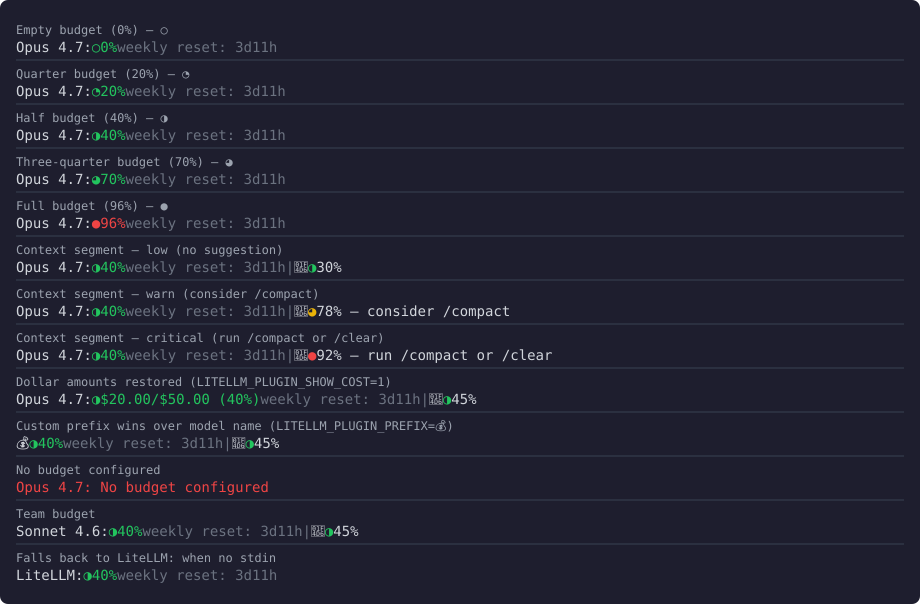

# Claude Code LiteLLM Plugin

A statusline plugin for Claude Code that displays LiteLLM budget information: usage percentage (optionally spend and max budget), time until reset, and context-window pressure. Optional VS Code and IntelliJ widgets show the same line in the editor status bar.

## Install

**macOS / Linux**

```bash
curl -fsSL https://raw.githubusercontent.com/stvnksslr/claude-code-litellm-plugin/main/install.sh | bash
```

**Windows (PowerShell)**

```powershell
irm https://raw.githubusercontent.com/stvnksslr/claude-code-litellm-plugin/main/install.ps1 | iex
```

**Homebrew** (macOS / Linux) or **Scoop** (Windows)

```bash
brew install stvnksslr/tap/claude-code-litellm-plugin
claude-code-litellm-plugin setup
```

```powershell
scoop bucket add stvnksslr https://github.com/stvnksslr/scoop-bucket
scoop install claude-code-litellm-plugin
claude-code-litellm-plugin setup
```

The install scripts download the latest release, verify its SHA-256 checksum, install the binary (`~/.local/bin`, or `%LOCALAPPDATA%\Programs\claude-code-litellm-plugin` on Windows), run `setup`, and finish with `doctor`. Claude Code picks up the new status line immediately (no restart; the workspace must be trusted).

**Also install the VS Code extension** into every detected VS Code-family editor (`code`, `cursor`, `windsurf`, `codium`):

```bash
curl -fsSL https://raw.githubusercontent.com/stvnksslr/claude-code-litellm-plugin/main/install.sh | bash -s -- --editors
```

```powershell
& ([scriptblock]::Create((irm https://raw.githubusercontent.com/stvnksslr/claude-code-litellm-plugin/main/install.ps1))) -Editors
```

or, after any install method: `claude-code-litellm-plugin setup --editors`.

<details>
<summary>Installer options</summary>

| install.sh flag | install.ps1 parameter | Environment variable | Default |
|---|---|---|---|
| `--editors` | `-Editors` | `LITELLM_PLUGIN_EDITORS=1` | off |
| `--version X.Y.Z` | `-Version X.Y.Z` | `LITELLM_PLUGIN_VERSION` | latest release |
| `--install-dir DIR` | `-InstallDir DIR` | `LITELLM_PLUGIN_INSTALL_DIR` | see above |
| `--no-modify-path` | `-NoModifyPath` | `LITELLM_PLUGIN_NO_MODIFY_PATH=1` | PATH is updated |

Use the environment variables with the piped one-liners, e.g. `curl … | LITELLM_PLUGIN_VERSION=0.5.0 bash`.
</details>

### What `setup` does

`claude-code-litellm-plugin setup` adds this to Claude Code's settings (`~/.claude/settings.json`, or `$CLAUDE_CONFIG_DIR/settings.json`), keeping everything else in the file as it was:

```json
{
  "statusLine": {
    "type": "command",
    "command": "~/.local/bin/claude-code-litellm-plugin",
    "refreshInterval": 30
  }
}
```

- `command` is the path of the installed binary, so it works even when the install directory isn't on `PATH`.
- `refreshInterval` re-runs the status line every 30 seconds. Without it, Claude Code only refreshes on events (new messages, `/compact`, …), so an idle session keeps showing what it rendered at launch. The plugin caches budget data for 30s, so lower values don't fetch more often.
- If your `statusLine` already runs another tool, `setup` leaves it alone and says so; `setup --force` replaces it and saves the previous file as `settings.json.bak`.
- Other flags: `--dry-run` (print the result), `--remove` (undo), `--settings <file>` (e.g. a project's `.claude/settings.local.json`), `--command <cmd>`.

### Manual installation

1. Download the archive for your platform from the [releases page](https://github.com/stvnksslr/claude-code-litellm-plugin/releases) and check it against the release's `*_checksums.txt`.
2. Put `claude-code-litellm-plugin` somewhere stable (e.g. `~/.local/bin`). On macOS, a browser download is quarantined: run `xattr -d com.apple.quarantine ~/.local/bin/claude-code-litellm-plugin`.
3. Run `claude-code-litellm-plugin setup` (or add the `statusLine` block above yourself).

## Configure

The plugin needs your LiteLLM proxy URL and a key. **Put them in the `env` block of `~/.claude/settings.json`** — Claude Code passes it to the status line, and the editor widgets read the same block, so one place works everywhere:

```json
{
  "env": {
    "LITELLM_PROXY_URL": "https://your-litellm-instance.com",
    "LITELLM_PROXY_API_KEY": "your-api-key"
  }
}
```

`ANTHROPIC_BASE_URL` / `ANTHROPIC_AUTH_TOKEN` work too (the `LITELLM_*` names win). Shell-profile exports also work for the CLI, but editors launched from the Dock/Start menu may not see them.

Then check everything with:

```bash
claude-code-litellm-plugin doctor
```

### Environment variables

| Variable | Purpose |
|---|---|
| `LITELLM_PROXY_URL`, then `ANTHROPIC_BASE_URL` | LiteLLM proxy root URL |
| `LITELLM_PROXY_API_KEY`, then `ANTHROPIC_AUTH_TOKEN` | API key (see SSO below for the no-key option) |
| `LITELLM_PLUGIN_SHOW_COST=1` | show `$spend/$budget (pct%)` instead of just the percentage |
| `LITELLM_PLUGIN_PREFIX` | replace the model-name prefix (set to empty for none) |
| `LITELLM_PLUGIN_UPDATE_CHECK=0` | disable the hourly GitHub "update available" check (e.g. on restricted networks) |
| `LITELLM_PLUGIN_CLAUDE_CREDENTIALS_FILE` | read the gateway SSO token from this file only (disables the Keychain lookup) |
| `CLAUDE_CONFIG_DIR` | honored like Claude Code does: settings and credentials are read from that directory |

### SSO / gateway auth (no API key)

If Claude Code signs in through a LiteLLM gateway (`forceLoginMethod: "gateway"` managed setting + `/login` device flow, see the [LiteLLM gateway tutorial](https://docs.litellm.ai/docs/tutorials/claude_code_gateway)), the plugin can use the LiteLLM token Claude Code stores (`enterpriseGateway`) instead of an API key. It is only consulted when neither `LITELLM_PROXY_API_KEY` nor `ANTHROPIC_AUTH_TOKEN` is set, and budgets are read from `GET /user/info` — the gateway token is not a database key, so `/key/info` does not apply to it.

The token is only sent to the gateway that issued it:

- If `LITELLM_PROXY_URL` / `ANTHROPIC_BASE_URL` is set, its scheme, host, and port must match the gateway URL stored with the token; otherwise the token is withheld (`No API key` — `doctor` explains which origin it expected). If neither is set, the stored gateway URL is used.
- The gateway must use HTTPS (plain HTTP is only allowed to `localhost` / loopback).
- Claude Code's Anthropic OAuth token (`claudeAiOauth`) is never used — it is an Anthropic credential, not a LiteLLM one.

The plugin reads `~/.claude/.credentials.json` first. On macOS, Claude Code keeps credentials in the login Keychain (service `Claude Code-credentials`) instead, so the plugin then reads that item with `/usr/bin/security find-generic-password`. With a custom `CLAUDE_CONFIG_DIR`, Claude Code uses a different Keychain item whose name isn't documented, so the plugin skips the Keychain and only reads `$CLAUDE_CONFIG_DIR/.credentials.json` (use an API key otherwise).

> **Keychain prompt:** macOS may ask whether `security` can access the `Claude Code-credentials` item. **Allow** grants access once. **Always Allow** adds `/usr/bin/security` to the item's access list, which lets *any* process running as you read the item through `security` without a prompt. Prefer **Allow**, or set `LITELLM_PROXY_API_KEY` instead if the repeated prompt is a problem. To revoke an earlier "Always Allow", open Keychain Access → `Claude Code-credentials` → Get Info → Access Control and remove `security`.

Expired tokens are skipped — a gateway token lapses after ~24 hours (LiteLLM issues no refresh token), so run `/login` in Claude Code again when that happens. With multiple teams, the statusline shows the first team on your LiteLLM user record — the team LiteLLM scopes the gateway token to.

## Output

The plugin displays the active model, budget usage, and context-window pressure:

```
Opus 4.7: ◔ 12% weekly reset: 3d1h | 📖 ◑ 45%
```

- **Prefix** is the model display name from Claude Code's stdin (falls back to `LiteLLM:` when stdin is unavailable). Override with `LITELLM_PLUGIN_PREFIX`.
- **Circle gauge** fills clockwise as usage grows: `○` (0%) · `◔` (<30%) · `◑` (<60%) · `◕` (<85%) · `●` (85%+).
- **Color** thresholds for the budget circle: green `< 75%`, yellow `75–89%`, red `90%+`.
- **Reset countdown** shows time until the budget rolls over.
- **Context segment (`📖 ●`)** reports the current context-window usage from Claude Code. Color thresholds: green `< 70%`, yellow `70–84%`, red `85%+`. Warn and critical bands append `— consider /compact` and `— run /compact or /clear` respectively. The segment is hidden when stdin doesn't include context data (e.g. before the first API call in a session).
- **`update: X.Y.Z`** appears when a newer release exists (see [Update](#update)).

Only the team budget (or, for gateway SSO, your user budget when the team has none) is shown — never a single key's spend.



## Editor plugins

Status bar widgets for VS Code (and Cursor, Windsurf, VSCodium) and IntelliJ-based IDEs. They run the same binary with `--json`, which also loads the `env` block of Claude Code's settings — so nothing is configured twice. Click the widget to refresh.

**Install:** `claude-code-litellm-plugin setup --editors` installs the VS Code extension into every detected VS Code-family editor (or download `claude-code-litellm-<version>.vsix` from the [releases page](https://github.com/stvnksslr/claude-code-litellm-plugin/releases) and run `code --install-extension <file> --force`). For IntelliJ, download `claude-code-litellm-intellij-<version>.zip` from the releases page, then `Settings` → `Plugins` → ⚙ → `Install Plugin from Disk…`.

**Binary lookup** (both plugins): `~/.local/bin`, `/opt/homebrew/bin`, `/usr/local/bin`, `/home/linuxbrew/.linuxbrew/bin`, `%LOCALAPPDATA%\Programs\claude-code-litellm-plugin`, `~/scoop/shims`, then `PATH`. VS Code settings: `claudeCodeLitellm.binaryPath` (overrides the lookup; `~` is expanded) and `claudeCodeLitellm.refreshSeconds` (default 30). IntelliJ refreshes every 30 seconds.

Widget states: `binary not found` (install it or set the path), `timeout`, `update binary` (the installed binary is older than the extension — re-run the installer), or the status line itself. Hover for spend, reset, context and the binary version.

Marketplace publishing (VS Code Marketplace, Open VSX, JetBrains Marketplace) is not set up yet.

## Update

The status line shows `update: X.Y.Z` when a new release exists. Update with whatever you installed with: re-run the install one-liner, `brew upgrade claude-code-litellm-plugin`, or `scoop update claude-code-litellm-plugin`. Re-run `claude-code-litellm-plugin setup --editors` to update the VS Code extension too.

## Uninstall

```bash
claude-code-litellm-plugin setup --remove      # removes the statusLine entry
rm ~/.local/bin/claude-code-litellm-plugin     # or: brew uninstall / scoop uninstall
rm -rf ~/.cache/claude-code-litellm            # cached budget data
```

The installer's PATH line is marked `# Added by claude-code-litellm-plugin installer` in your shell profile (fish: `~/.config/fish/conf.d/claude-code-litellm-plugin.fish`).

## Troubleshooting

Start with **`claude-code-litellm-plugin doctor`**. It shows where each setting comes from (shell or `settings.json`), which credential is used (never the token itself), whether the `statusLine` entry points at this binary, and runs a live budget request with the full error and a hint.

Status line messages:

- `No API key` - Set `LITELLM_PROXY_API_KEY` (or `ANTHROPIC_AUTH_TOKEN`), or sign in to Claude Code through a LiteLLM gateway (`/login`). With gateway SSO, also check the token hasn't expired and that `LITELLM_PROXY_URL` / `ANTHROPIC_BASE_URL` (if set) points at the same HTTPS host as the gateway
- `No proxy URL` - A key is set but no proxy URL: set `LITELLM_PROXY_URL` or `ANTHROPIC_BASE_URL` (the LiteLLM root, without `/v1`)
- `No budget configured` - Your LiteLLM team (or, with gateway SSO, your user) has no `max_budget`; set one in LiteLLM to see budget info
- `Auth error` - The proxy rejected the key; with gateway SSO the token may have lapsed — run `/login` in Claude Code again
- `Connection error` - Check the proxy URL and your network/VPN (behind a proxy, set `HTTPS_PROXY`). Since Go 1.27 a TLS failure can also come from the gateway itself:
  - Its certificate lists an IPv4-mapped IPv6 address (`::ffff:a.b.c.d`) as an IP SAN, or its CA has such an IP name constraint. Go now rejects these certificates outright and there is no opt-out; reissue the certificate with a plain IPv4 address (`IP:127.0.0.1`)
  - It only offers TLS 1.2 RSA-key-exchange (`TLS_RSA_*`) or 3DES cipher suites. The old `GODEBUG=tlsrsakex=1` / `tls3des=1` workarounds no longer exist; enable an ECDHE suite on the gateway or its TLS terminator
- `Error` - Any other failure (e.g. an HTTP 404 when the URL isn't the LiteLLM root); `doctor` prints the full response

The status line is blank:

- Run `claude-code-litellm-plugin doctor` and check the `statusLine` lines
- Accept the workspace trust prompt — Claude Code doesn't run the status line in untrusted folders
- Managed settings with `allowManagedHooksOnly` or `disableAllHooks` silently disable user status lines (`doctor` warns about this)
- `claude --debug` logs the status line command's stderr and exit code
- If running `claude-code-litellm-plugin --version` prints `fatal error: removed GODEBUG "..." set to old value "..." in environment`, your environment (shell profile or the `env` block in Claude Code settings) sets a `GODEBUG` option that Go 1.27 removed, e.g. `x509sha1=1`, `tlsrsakex=1`, `tls3des=1` or `asynctimerchan=1`. Remove that entry from `GODEBUG`; release binaries from Go 1.27 onward refuse to start with it set

## Development

This repo uses [mise](https://mise.jdx.dev) to pin the Go, Node, Java, golangci-lint and GoReleaser versions (see `mise.toml`). After cloning:

```bash
mise install
```

Common tasks:

```bash
mise run build            # statusline binary (version from git describe)
mise run install:local    # build, copy to ~/.local/bin, run setup
mise run test             # Go tests (regenerates examples.svg — commit any change)
mise run lint             # go fmt + tidy + golangci-lint

mise run vscode:build     # VS Code .vsix
mise run vscode:install   # build the .vsix and install it into detected editors
mise run intellij:build   # IntelliJ plugin zip
mise run intellij:run     # sandbox IntelliJ with the plugin loaded

mise run release:snapshot # dry-run the full release into dist/
```

Run the statusline locally with a sample payload:

```bash
echo '{"model":{"display_name":"Opus"}}' | go run .
go run . doctor
```

Releases: `./release.sh --type=patch|minor|major` (checks you're on a clean, pushed, CI-green `main`) pushes a tag; the Release workflow tests, builds the binaries and editor plugins, and publishes the GitHub release, Homebrew cask and Scoop manifest in one go. `--pre=rc.1` makes a prerelease tag for smoke-testing installers (`LITELLM_PLUGIN_VERSION=0.5.0-rc.1 bash install.sh`). The Homebrew/Scoop step needs a `HOMEBREW_TAP_TOKEN` secret with write access to `stvnksslr/homebrew-tap` and `stvnksslr/scoop-bucket`; without it that step is skipped.
